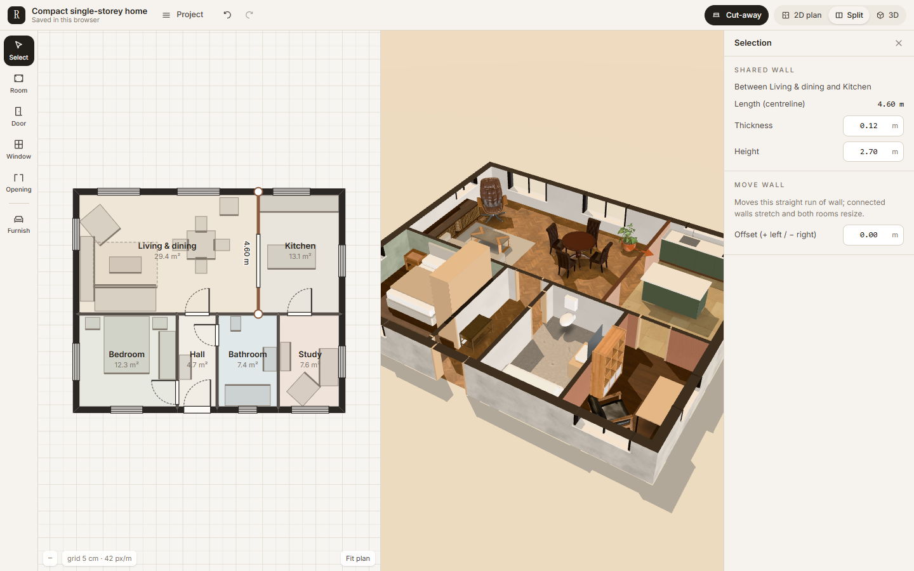

# Roomset — building editor foundation

A browser-based 2D/3D home-design editor built on a structured, dimension-aware building model.
Draw and reshape rooms in a floor plan or directly in 3D. Add doors and windows and furnish rooms.
Then walk through the result in first person. Both views edit **one** canonical model, so they cannot
disagree.

This is the foundation milestone of a larger platform for developers, custom builders and interior
studios. The Phase 1 client configurator is still available at [`/garden-room`](docs/GARDEN_ROOM.md).



## Run it

Node 20+ (developed on Node 24).

```bash
npm install
npm run dev            # editor at http://localhost:5173/   ·   Phase 1 at /garden-room
```

| Command | What it does |
|---|---|
| `npm run build` / `npm run preview` | Production build; preview on :4173 with the production security headers |
| `npm test` | 61 unit tests: engine geometry, commands, invariants, history, persistence, collision, navigation and framing, performance budgets, plus Garden Room |
| `npm run test:e2e` | Playwright on the production build: desktop, tablet and phone (first run: `npx playwright install chromium`) |
| `npm run typecheck` / `npm run lint` | `tsc -b` / oxlint |

No backend, accounts, API keys or paid services are needed. Projects autosave to this browser and can be
exported and imported as JSON.

## What works today

- **Canonical building model.** Corners and walls form a planar graph per level. Rooms are explicit wall
  cycles, openings are hosted on a wall, and items carry their own placement. Units are metres, the
  schema is versioned, and IDs are stable. See [ARCHITECTURE](docs/ARCHITECTURE.md).
- **2D plan editor.**
  - Drag to draw rooms. They join existing walls, split walls into T-junctions, and share walls with
    neighbours.
  - Drag walls (the whole straight run), corners, doors, windows and furniture, with 5 cm grid and
    alignment snapping.
  - Live wall lengths and net room areas; pan and zoom.
- **3D view** derived from the model:
  - mitred wall junctions, per-room wall finishes on each side, an exterior render;
  - door leaves, frames and glazing, textured floors;
  - CC0/CC-BY furniture models plus fixtures modelled in code;
  - a cut-away overhead mode.
- **Direct 3D editing.** Click to select, then drag walls, openings or furniture. Door, window and
  furniture tools also work by clicking in 3D. These go through the same commands as 2D.
- **Numeric editing.** Room width and depth, wall thickness, height and offset, and opening size, sill
  and position along the wall.
- **Validation.** Every edit is checked against the whole building. Invalid edits are rejected with a
  reason, and drags stop at the last valid position and say why. Openings stay inside their walls, and
  furniture is pushed back into its room when a wall moves into it.
- **Undo and redo** for every edit, including each drag as one step. Autosave, plus JSON export and import,
  with strict validation of anything loaded.
- **Three camera modes.**
  - **Orbit / inspect:** whole-home framing that fits any viewport; overview, top and four elevation
    presets; frame selection (F) and frame home (H).
  - **Walk through (full screen):**
    - click to capture the mouse, then free look (full turn, ±85° up and down, no roll);
    - WASD with smooth acceleration, Shift to run, arrow keys to turn;
    - collision with walls and furniture through real doorways (windows stay closed);
    - "Go to room" places you facing into the room;
    - adjustable look sensitivity and speed;
    - Esc releases the mouse, a second Esc returns to the editor where you left it.
  - **Free camera (full screen):** fly through anything, with E/Q (or Space/C) for up and down, the
    wheel for speed and preset viewpoints (aerial, street, garden, inside each room).
  - Phones and tablets get a touch joystick, look pad and up/down buttons.
- **Template.** A compact six-room home (about 82 m² gross) built entirely through the public
  commands. A blank project is also available.

## Documentation

| | |
|---|---|
| [ARCHITECTURE.md](docs/ARCHITECTURE.md) | model, invariants, commands, geometry, sync, rendering, walkthrough, persistence |
| [DECISIONS.md](docs/DECISIONS.md) | D1–D10 with the alternatives rejected |
| [RESEARCH.md](docs/RESEARCH.md) | sources and what they changed (Phase 1 and this milestone) |
| [TESTING.md](docs/TESTING.md) | test layers, results, performance measurements, what is not verified |
| [SECURITY.md](docs/SECURITY.md) | checks, review notes, residual risks |
| [PROGRESS.md](docs/PROGRESS.md) · [AUDIT_LOG.md](docs/AUDIT_LOG.md) | per-milestone status, commits and evidence |

## Assets and licences

Furniture and texture sources are listed per asset in `src/engine/assets/catalog.ts`, which records
the licence, attribution and source URL.
- **Poly Haven models and textures:** CC0.
- **"Glam Velvet Sofa":** © 2021 Wayfair LLC, model by Eric Chadwick (Khronos glTF Sample Assets),
  **CC BY 4.0, attribution required.**
- **Kitchen, bed, wardrobe, bath, vanity, WC, desk, rug and the Arlo sofa:** modelled in code. They are
  labelled that way in the library and are placeholder quality, not photoreal.
- **Fonts:** Instrument Serif and Inter, SIL OFL 1.1.

## Known limitations

- **One level is edited and walked at a time.** The schema supports multiple levels (`addLevel`), but
  there is no UI or stairs for them yet.
- **Rooms are drawn as rectangles,** then reshaped by moving corners. There's no free polygon tool or
  curved walls. Walls can only be deleted together with their room.
- **No rotation gizmo in 3D.** Rotate with the 2D handle, the inspector or the Q key.
- **No roof is modelled.** From above, the free camera looks into the rooms (ceilings are single-sided).
- **Tall furniture blocks the cut-away view.** It rises above the lowered walls and can hide
  neighbouring rooms from the overhead camera.
- **Doors are always open,** and window views show a plain sky.
- **Visual quality is mixed.** Scanned models sit next to simple code-modelled fixtures, and the
  lighting is real-time with no global illumination.
- **Phones:** viewing and walkthrough only, by design.
