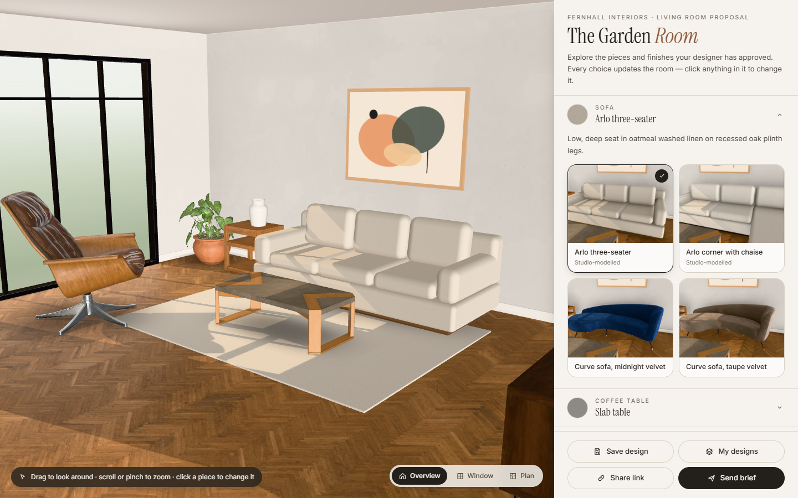

# The Garden Room — Phase 1 configurator (now served at `/garden-room`)

A client-facing 3D room configurator for interior design studios. A studio presents a curated room; the client
explores approved furniture and finishes in real time, saves and compares variants, shares a link, and submits a
structured brief back to the studio.

The demo studio, **Fernhall Interiors**, is fictional. Products are illustrative: no prices, stock or supplier
relationships are implied.



## Run it

Requires Node 20+ (developed on Node 24).

```bash
npm install
npm run dev          # http://localhost:5173
```

| Command | What it does |
|---|---|
| `npm run build` | Type-check + production build into `dist/` |
| `npm run preview` | Serve the build on :4173 **with the production security headers** |
| `npm test` | Unit tests (Vitest): config validation, URL round-trips, brief rules, storage hardening, asset integrity, header parity |
| `npm run test:e2e` | Playwright end-to-end tests against the production build (desktop, tablet, mobile). First run: `npx playwright install chromium` |
| `npm run lint` / `npm run typecheck` | oxlint / `tsc -b` |
| `npm run headers` | Regenerate `public/_headers` + `vercel.json` from the CSP in `vite.config.ts` |

No backend, accounts or API keys are needed.

## What it does

- **3D living room.** React Three Fiber renders it with real PBR materials, warm sun through floor-to-ceiling glazing, soft window skylight, an HDR environment, shadow-mapped sunlight and contact shadows.
- **Camera.** Orbit, zoom (to cursor) and pan with mouse or touch, inside a bounded room. There are Overview, Window and Plan presets, and choosing a group frames that object. Walls are single-sided, so orbiting behind one opens the room like a dollhouse instead of clipping.
- **Five customisation groups, each changing real scene content:**

| Group | Options | What changes in 3D |
|---|---|---|
| Sofa | Arlo three-seater (linen) · Arlo corner with chaise (bouclé) · Curve sofa in midnight or taupe velvet | Geometry: the parametric sofa is rebuilt straight or L-shaped; the glTF sofa switches via `KHR_materials_variants` |
| Coffee table | Slab (concrete/oak) · Ellipse plinth (travertine-effect) · Ribbon round (stone/steel) · Lattice (ebonised) | Model swap |
| Flooring | Oak herringbone · Smoked oak plank · Warm microcement · Honed limestone | Floor material (tiles at true physical scale) |
| Walls | Chalk white · Sage limewash · Terracotta clay plaster · Ink blue · Fluted oak feature wall | Wall materials; fluted oak adds a fluted normal-mapped feature wall |
| Rug | Ivory bouclé · Round jute · Charcoal herringbone · Rust wool with bound edge · No rug | Shape, size and material |

- **Click to select.** Clicking any piece in the room opens its options.
- **Loading behaviour.** While a newly chosen asset loads, the previous one stays visible and the chosen card shows a spinner. Every other option prefetches in the background after the first load.
- **Failure handling.** If one asset fails, only that object is skipped: the option is flagged and a toast explains. Without WebGL, the 3D view is replaced by an explanation and the rest of the app still works.

### Workflows

| Workflow | How it works |
|---|---|
| **Save / restore** | "Save design" stores `{id, name, config, savedAt}` in `localStorage` (named Design A, B, …; up to 12; duplicates detected). Saved designs can be renamed, deleted and shown in the room. The working design is also remembered, so a reload resumes where the client left off. |
| **Compare** | Pick two saved designs. The panel switches to a side-by-side table that marks the differing groups, and an A/B toggle flips the room between the two. Neither saved design is modified. "Back" restores the pre-compare design; "Continue with A/B" adopts the variant on screen. |
| **Share** | `?v=1&room=garden-room&sofa=…&table=…&floor=…&wall=…&rug=…` holds stable option IDs only, never personal data. On load, each field is validated against the catalogue allowlist (pattern + exact match, length cap, duplicate keys rejected). A partially valid link keeps the valid fields and explains which defaults were used; a wrong template or garbage link falls back to the studio default with an error notice. The link is consumed and the address bar cleaned, so a reload doesn't re-announce it. |
| **Brief** | Fields are name, email, optional phone, preferred contact (phone becomes required if chosen) and notes (≤1000 characters). Validation errors appear inline with focus moved to the first invalid field. Inputs are normalised and control characters stripped. The brief (reference `FH-YYYY-XXXXXX`, configuration and share link) is stored **locally only**. The confirmation shows every captured detail and offers copy-as-text and print. It says plainly that nothing was sent. |

## Architecture

```
src/
  domain/      Pure data & logic, no React/three: option catalogue, Configuration type,
               validation, share-URL encode/parse, diffing, brief validation
  lib/         localStorage persistence (re-validated on read), clipboard, media query
  state/       One small Zustand store: config, active group, saved designs, compare, dialogs, toasts,
               and `rendered` — what the 3D scene has actually committed
  scene/       R3F scene: Room (floor/walls/window), Furniture (parametric sofa, tables, rugs),
               Model (glTF + material variants + contact shadow), Styling (fixed décor), CameraRig, views
  ui/          Panel, option grid (native radio groups), dialogs (native <dialog>), compare panel, toasts
```

- **Configuration is data.** It holds `templateId` plus five stable option IDs. Option definitions in `catalog.ts` hold visual specs (asset URL, texture, tile size, tint); the scene interprets them and the UI lists them.
- **UI and 3D stay in sync, and the sync is checked.** The scene renders a deferred copy of the configuration inside a React transition, then reports the configuration it actually committed (`state.rendered`, exposed as `data-rendered` on `<main>`). The UI uses this to show per-option loading; the E2E tests use it to assert that the scene really shows what was chosen.
- **Materials tile at physical size.** Geometry carries UVs in metres (box projection), so a 27 cm linen weave, 3.4 m parquet repeat and 1.5 m limestone flags all read at true scale on any shape.
- **Asset pipeline.** Models are packed with glTF-Transform (meshopt geometry plus WebP textures at 1024 px). PBR textures are resized to WebP, tintable ones are converted to normalised greyscale so curated colours are exact, and roughness maps are remapped to plausible ranges. Total assets are ≈7.6 MB, all self-hosted. Only the current selection blocks first render.

## 3D assets and licences

| Asset | Source | Licence |
|---|---|---|
| Curve velvet sofa (both colourways) | "Glam Velvet Sofa" © 2021 Wayfair LLC, model by Eric Chadwick — [Khronos glTF Sample Assets](https://github.com/KhronosGroup/glTF-Sample-Assets/tree/main/Models/GlamVelvetSofa) | **CC BY 4.0 — attribution required** (shown in-app under *About this demo & credits*) |
| Coffee tables (Slab, Ribbon, Lattice), lounge chair, side table, console, vases, plant | [Poly Haven](https://polyhaven.com) — Amin, Ulan Cabanilla, Kuutti Siitonen, James Ray Cock, Patrik Pangerl, Rico Cilliers | CC0 |
| All floor, wall, stone and fabric textures; HDR environment (`small_empty_room_1`) | Poly Haven | CC0 |
| Arlo sofas, Ellipse plinth, rugs, room shell, window, artwork | Modelled in code for this prototype | Project code |
| Instrument Serif, Inter | Self-hosted via @fontsource | SIL OFL 1.1 |

Modifications: compression, texture resizing and recolouring.

## Known limitations

- The parametric Arlo sofas are deliberately simple rounded-block upholstery. They read as contemporary modular sofas, not as specific products, and are labelled *studio-modelled*.
- Contact shadows are soft blob shadows rather than screen-space AO. AO looked better but caused 300–900 ms GPU stalls at the start of camera moves on integrated GPUs (see [TESTING.md](TESTING.md)).
- The view outside the window is an abstract gradient.
- One room template, not editable by a studio yet; no backend; briefs aren't transmitted.
- The three.js bundle is ≈400 KB gzipped, and the first load fetches ≈4–5 MB of assets.

See [RESEARCH.md](RESEARCH.md), [TESTING.md](TESTING.md) and [SECURITY.md](SECURITY.md).
